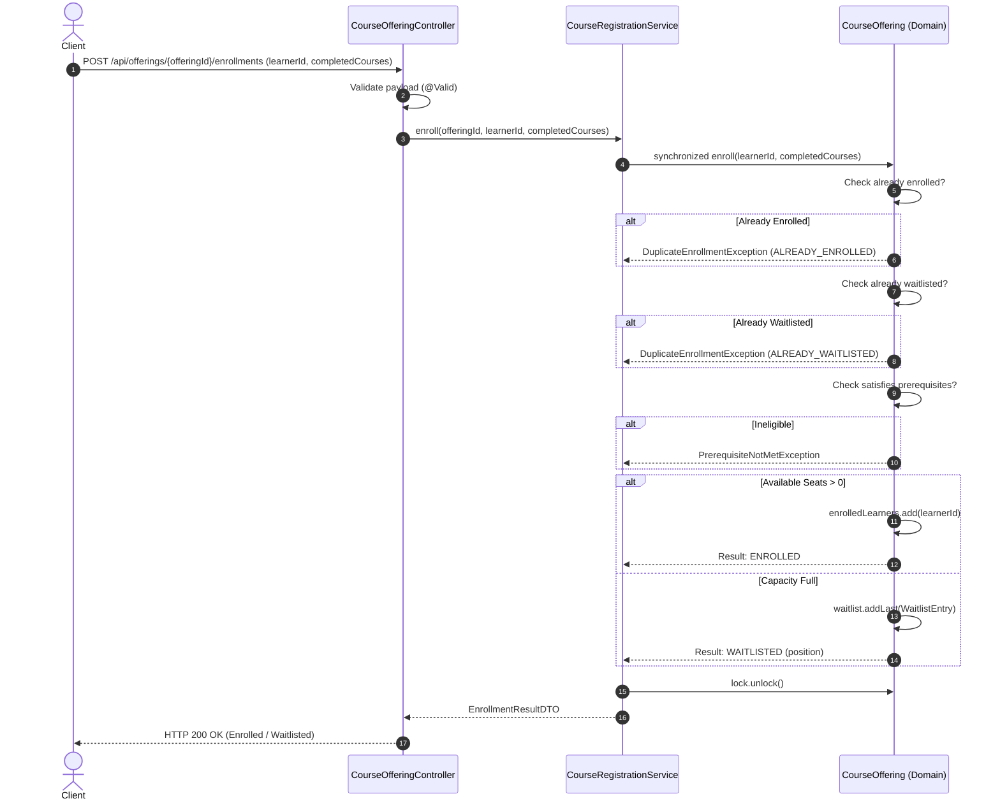
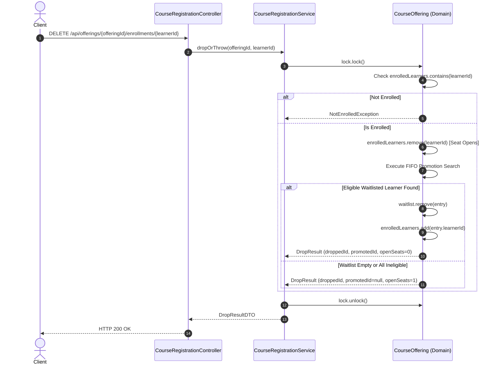
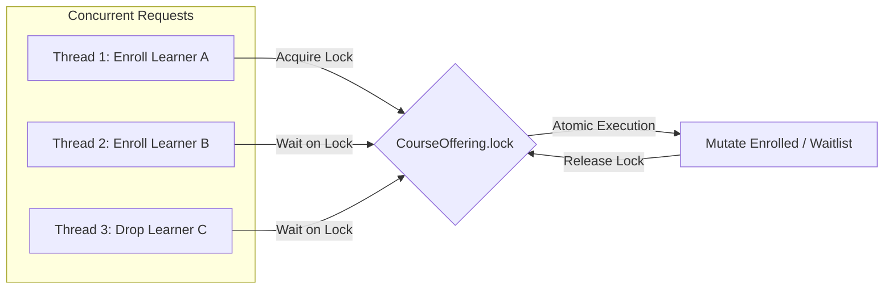

# System Design Specification: Course Registration and FIFO Waitlist

**Project**: `course-registration-waitlist`  
**Phase**: Phase 2 — Requirements Definition & Design Specification  
**Architecture Style**: Layered Spring Boot Application (In-Memory, Thread-Safe)  
**Target Platform**: Java 25 / Spring Boot 4.1.0  

---

## 1. Scope and Assumptions

### 1.1 Feature Boundary
The service slice is strictly bounded to the lifecycle of **one course offering**:
- Direct enrollment of eligible learners while capacity permits.
- Automatic FIFO waitlisting when capacity is exhausted.
- Dropping currently enrolled learners.
- Automatic promotion of the earliest eligible waitlisted learner upon seat vacancy.

### 1.2 Explicit Non-Goals (Out of Scope)
- No user authentication, RBAC, or learner account management.
- No course catalog management, search, or multi-course dependency trees.
- No multi-term registration, credit caps, or schedule conflict resolution.
- No external persistence (SQL/NoSQL database) or caching infrastructure.
- No frontend UI, payments, or cloud deployment templates.
- No configurable policy engine (rules are explicitly codified to this specification).

### 1.3 Key Assumptions
1. **Single Course Offering**: The system manages exactly one configured course offering with a predefined `courseId`, `capacity` ($N > 0$), and a set of required `prerequisites`.
2. **Deterministic Eligibility**: Learner eligibility is determined by comparing the learner's set of completed course codes against the course offering's required prerequisite codes. A learner is eligible if and only if:
   $$\text{prerequisites} \subseteq \text{learner.completedCourses}$$
3. **In-Memory Volatility**: Storage is strictly in-memory. State is reset when the application process terminates or restarts.
4. **Immediate Eager Promotion**: When an enrolled learner drops, seat reallocation occurs immediately and synchronously without requiring the promoted learner to accept a reservation token.
5. **Enrolled Drops Only**: A learner may execute a drop request only if they are currently enrolled (Business Rule 5).

---

## 2. Domain Model

```
+-------------------------------------------------------------------+
|                          CourseOffering                           |
+-------------------------------------------------------------------+
| - courseId: String                                                |
| - courseCode: String                                              |
| - title: String                                                   |
| - capacity: int                                                   |
| - prerequisites: Set<String>                                      |
| - enrolledLearners: LinkedHashSet<String>                         |
| - waitlist: LinkedList<WaitlistEntry>                             |
| - lock: ReentrantLock                                             |
+-------------------------------------------------------------------+
| + isEligible(learnerCourses: Set<String>): boolean                |
| + enroll(learnerId: String, completedCourses: Set<String>): Result|
| + drop(learnerId: String): DropResult                             |
| + getSnapshot(): CourseStatusSnapshot                             |
+-------------------------------------------------------------------+
                               |
                               | 1 contains 0..*
                               v
+-------------------------------------------------------------------+
|                          WaitlistEntry                            |
+-------------------------------------------------------------------+
| - learnerId: String                                               |
| - completedCourses: Set<String>                                   |
| - joinedAt: Instant                                               |
+-------------------------------------------------------------------+
```

### 2.1 Identifiers & Domain Types
- `courseId` (`String`): Unique identifier of the course offering (e.g., `CS-201`).
- `learnerId` (`String`): Unique identifier of the student/learner (e.g., `learner-001`). Non-blank, trimmed.
- `prerequisites` (`Set<String>`): Set of course codes required before enrolling (e.g., `["CS-101"]`).
- `completedCourses` (`Set<String>`): Set of course codes completed by the learner.

### 2.2 Domain Status Enums
```java
public enum RegistrationStatus {
    ENROLLED,
    WAITLISTED,
    DROPPED
}

public enum RejectionReason {
    PREREQUISITE_NOT_MET,
    ALREADY_ENROLLED,
    ALREADY_WAITLISTED,
    NOT_ENROLLED,
    INVALID_REQUEST
}
```

### 2.3 Data Structures & Collection Semantics
1. **`enrolledLearners`**: `LinkedHashSet<String>`
   - Guarantees $O(1)$ constant-time lookups for enrollment verification and duplicate rejection.
   - Maintains insertion order for auditing and deterministic representation.
   - Enforces uniqueness: cannot contain duplicate learner IDs.
2. **`waitlist`**: `LinkedList<WaitlistEntry>`
   - Implements strict FIFO queue behavior (appends to tail via `addLast()`).
   - Allows safe indexed traversal and in-place removal of the promoted entry via `Iterator.remove()` without disrupting the relative order of retained entries.
3. **`lock`**: `ReentrantLock`
   - Encapsulated within the `CourseOffering` aggregate root.
   - Guards all mutations across `enrolledLearners` and `waitlist` within an atomic critical section.

---

## 3. Service Responsibilities & Layered Architecture

```mermaid
flowchart TD
    Client[HTTP Client / REST] --> Controller[CourseOfferingController]
    Controller -->|DTO to Service| Service[CourseRegistrationService]
    Service -->|Atomic Mutex| Offering[CourseOffering Aggregate]
    Service <--> OfferingRepo[CourseOfferingRepository (In-Memory)]
    Service <--> LearnerRepo[LearnerRepository (In-Memory)]
    Controller -.-> GlobalExceptionHandler[GlobalExceptionHandler]
```

### 3.1 Layer Responsibilities

| Layer | Component | Core Responsibility |
| :--- | :--- | :--- |
| **Web / Controller** | `CourseOfferingController` | Exposes REST endpoints (`/api/offerings/...`), validates incoming request bodies (`@Valid`), delegates to `CourseRegistrationService`, and returns strongly-typed DTOs. |
| **Error Handling** | `GlobalExceptionHandler` | `@RestControllerAdvice` converting domain and validation exceptions into standardized `ErrorResponse` payloads without exposing stack traces. |
| **Application / Service** | `CourseRegistrationService` | Orchestrates enrollment and drop use cases, coordinates repository lookups (`CourseOfferingRepository`, `LearnerRepository`), and preserves invariants. |
| **Domain Model** | `CourseOffering`, `Learner`, `WaitlistEntry` | Enforces capacity bounds, prerequisite verification, FIFO waitlist insertion, skip-and-retain promotion, and duplicate prevention. |
| **Storage / Persistence** | `CourseOfferingRepository`, `LearnerRepository` | Thread-safe in-memory storage abstractions backed by `ConcurrentHashMap`. |

---

## 4. API Contract

Base URL: `/api/offerings`

### 4.1 Endpoints Summary

| Method | Endpoint | Purpose | Success Code | Error Codes |
| :--- | :--- | :--- | :---: | :---: |
| `POST` | `/api/offerings/{offeringId}/enrollments` | Request direct enrollment or FIFO waitlisting | `200 OK` | `400`, `404`, `409` |
| `DELETE` | `/api/offerings/{offeringId}/enrollments/{learnerId}` | Drop an enrolled learner & trigger FIFO promotion | `200 OK` | `400`, `404` |
| `GET` | `/api/offerings/{offeringId}` | Query capacity, enrolled list, and waitlist queue | `200 OK` | `404` |

---

### 4.2 Detailed Specifications

#### 1. Enroll Learner
- **URL**: `POST /api/offerings/{offeringId}/enrollments`
- **Request Body**:
```json
{
  "learnerId": "student-101",
  "completedCourses": ["CS-101"]
}
```
- **Validation**:
  - `learnerId`: `@NotBlank(message = "learnerId is required and must not be blank")`
  - `completedCourses`: Optional list of completed prerequisite course codes.

- **Success Response — Enrolled Directly (Seat Available)**:
  - **HTTP Status**: `200 OK`
```json
{
  "offeringId": "CS-201",
  "learnerId": "student-101",
  "status": "ENROLLED",
  "waitlistPosition": null,
  "message": "Learner successfully enrolled."
}
```

- **Success Response — Placed on Waitlist (Course Full)**:
  - **HTTP Status**: `200 OK`
```json
{
  "offeringId": "CS-201",
  "learnerId": "student-102",
  "status": "WAITLISTED",
  "waitlistPosition": 1,
  "message": "Offering is full; learner placed on waitlist at position 1."
}
```

- **Error Responses**:
  - `400 Bad Request`: Ineligible learner (Prerequisite not met)
    ```json
    {
      "timestamp": "2026-10-22T23:00:00Z",
      "status": 400,
      "error": "Bad Request",
      "code": "PREREQUISITE_NOT_MET",
      "message": "Learner 'student-ineligible' does not satisfy required prerequisites: [CS-101]. Completed: [MATH-099]",
      "path": "/api/offerings/CS-201/enrollments"
    }
    ```
  - `400 Bad Request`: Blank learner ID (Validation failure)
    ```json
    {
      "timestamp": "2026-10-22T23:00:00Z",
      "status": 400,
      "error": "Bad Request",
      "code": "VALIDATION_FAILED",
      "message": "learnerId is required and must not be blank",
      "path": "/api/offerings/CS-201/enrollments"
    }
    ```
  - `409 Conflict`: Learner already enrolled
    ```json
    {
      "timestamp": "2026-10-22T23:00:00Z",
      "status": 409,
      "error": "Conflict",
      "code": "ALREADY_ENROLLED",
      "message": "Learner 'student-101' is already enrolled in this course offering.",
      "path": "/api/offerings/CS-201/enrollments"
    }
    ```
  - `409 Conflict`: Learner already waitlisted
    ```json
    {
      "timestamp": "2026-10-22T23:00:00Z",
      "status": 409,
      "error": "Conflict",
      "code": "ALREADY_WAITLISTED",
      "message": "Learner 'student-102' is already waitlisted for this course offering.",
      "path": "/api/offerings/CS-201/enrollments"
    }
    ```
  - `404 Not Found`: Course offering not found
    ```json
    {
      "timestamp": "2026-10-22T23:00:00Z",
      "status": 404,
      "error": "Not Found",
      "code": "OFFERING_NOT_FOUND",
      "message": "Course offering not found: CS-999",
      "path": "/api/offerings/CS-999/enrollments"
    }
    ```

---

#### 2. Drop Learner
- **URL**: `DELETE /api/offerings/{offeringId}/enrollments/{learnerId}`

- **Success Response — Dropped with Waitlist Promotion**:
  - **HTTP Status**: `200 OK`
```json
{
  "offeringId": "CS-201",
  "droppedLearnerId": "student-101",
  "status": "DROPPED",
  "promotedLearnerId": "student-102",
  "availableCapacity": 0,
  "message": "Learner 'student-101' dropped. Promoted learner 'student-102' from waitlist."
}
```

- **Success Response — Dropped without Promotion (Waitlist empty or all ineligible)**:
  - **HTTP Status**: `200 OK`
```json
{
  "offeringId": "CS-201",
  "droppedLearnerId": "student-101",
  "status": "DROPPED",
  "promotedLearnerId": null,
  "availableCapacity": 1,
  "message": "Learner 'student-101' dropped. Seat remains vacant."
}
```

- **Error Responses**:
  - `404 Not Found`: Learner not currently enrolled
    ```json
    {
      "timestamp": "2026-10-22T23:00:00Z",
      "status": 404,
      "error": "Not Found",
      "code": "NOT_ENROLLED",
      "message": "Learner 'student-101' is not currently enrolled in this course offering.",
      "path": "/api/offerings/CS-201/enrollments/student-101"
    }
    ```

---

#### 3. Course Offering Status
- **URL**: `GET /api/offerings/{offeringId}`
- **HTTP Status**: `200 OK`
```json
{
  "offeringId": "CS-201",
  "courseCode": "CS201",
  "title": "Data Structures & Algorithms",
  "capacity": 3,
  "enrolledCount": 3,
  "availableSeats": 0,
  "waitlistCount": 2,
  "prerequisites": ["CS-101"],
  "enrolledLearners": [
    "student-101",
    "student-102",
    "student-103"
  ],
  "waitlist": [
    {
      "position": 1,
      "learnerId": "student-104",
      "joinedAt": "2026-10-22T22:30:00Z"
    },
    {
      "position": 2,
      "learnerId": "student-105",
      "joinedAt": "2026-10-22T22:31:00Z"
    }
  ]
}
```

---

## 5. Enrollment and Drop Workflows

### 5.1 Enrollment Workflow



---

### 5.2 Drop and Promotion Workflow



---

## 6. FIFO Promotion Policy ("Skip and Retain")

Business Rules 6, 7, 8, 9, and 10 define the exact algorithm for filling an opened seat.

### 6.1 Algorithm Specification
```text
Algorithm: AttemptPromotion(courseOffering)
Input: CourseOffering with enrolledCount < capacity
Output: Optional<String> promotedLearnerId

1. If courseOffering.waitlist is empty:
     Return EMPTY (Seat remains vacant)

2. Initialize iterator: it = courseOffering.waitlist.iterator()

3. While it.hasNext():
     entry = it.next()
     
     // Check eligibility against current course prerequisites
     If courseOffering.isEligible(entry.completedCourses):
         // Earliest eligible learner found!
         it.remove()                           // Dequeue from waitlist
         courseOffering.enrolledLearners.add(entry.learnerId) // Enroll
         Return OPTIONAL(entry.learnerId)      // Stop promotion search
     Else:
         // Business Rule 8: Skip ineligible learner, retain in queue
         Continue searching to the next entry in FIFO order (Business Rule 9)

4. If all waitlisted entries evaluated and none eligible:
     // Business Rule 10: Leave seat vacant
     Return EMPTY
```

### 6.2 Skip and Retain Scenario Trace
Suppose Course Offering `CS-201` has capacity 2 and requires prerequisite `CS-101`:
1. Current State:
   - Enrolled: `[Alice, Bob]` (Capacity full: 2/2)
   - Waitlist (FIFO):
     - Pos 1: `Charlie` (Completed: `[]` — Ineligible)
     - Pos 2: `Diana` (Completed: `["CS-101"]` — Eligible)
     - Pos 3: `Eve` (Completed: `["CS-101"]` — Eligible)
2. **Action**: `Bob` drops.
   - Enrolled becomes: `[Alice]` (1/2 seats occupied).
   - Seat opened: 1.
3. **Promotion Step**:
   - Inspect Pos 1 (`Charlie`): Ineligible. **Skip and retain `Charlie` at position 1**.
   - Inspect Pos 2 (`Diana`): Eligible. **Promote `Diana`**. `Diana` is removed from waitlist.
4. Resulting State:
   - Enrolled: `[Alice, Diana]` (2/2 seats occupied).
   - Waitlist:
     - Pos 1: `Charlie` (still waiting).
     - Pos 2: `Eve`.
   - Invariants preserved: Capacity is 2; `Charlie` did not lose his place in line; `Diana` was promoted without waiting on `Charlie`.

---

## 7. State Invariants

The implementation guarantees five mathematical invariants across every operation:

$$\begin{aligned}
\text{Inv 1 (Capacity Bound):} \quad & 0 \le |\text{Enrolled}| \le \text{Capacity} \\
\text{Inv 2 (Mutual Exclusivity):} \quad & \text{Enrolled} \cap \text{Waitlist} = \emptyset \\
\text{Inv 3 (Set Uniqueness):} \quad & \forall x, y \in \text{Waitlist}, x \ne y \implies x.\text{learnerId} \ne y.\text{learnerId} \\
\text{Inv 4 (Strict FIFO Queue):} \quad & \forall i < j, \quad \text{Waitlist}[i].\text{joinedAt} \le \text{Waitlist}[j].\text{joinedAt} \\
\text{Inv 5 (State Integrity):} \quad & \text{Operation Failure} \implies \Delta(\text{State}) = \emptyset
\end{aligned}$$

- **Proof of Inv 1**: A learner is added to `Enrolled` only if $|\text{Enrolled}| < \text{Capacity}$. Promotion is triggered only when $|\text{Enrolled}| < \text{Capacity}$ and adds at most one learner.
- **Proof of Inv 2**: Before entering `Enrolled` or `Waitlist`, checks ensure the learner is not present in either collection.
- **Proof of Inv 3**: Waitlist entry creation checks for existing presence prior to insertion.
- **Proof of Inv 5**: All validation checks (duplicate checks, prerequisite checks, existence checks) occur before state mutations. If an exception is thrown, state remains unaltered.

---

## 8. Persistence and Concurrency Approach

### 8.1 In-Memory Persistence Strategy
- In-memory storage is handled by `InMemoryCourseOfferingRepository`.
- Built on top of `ConcurrentHashMap<String, CourseOffering>` keyed by `courseId`.
- **Initialization**: A `@PostConstruct` or `@Bean` configuration populates the default course offering:
  - `courseId`: `CS-201`
  - `title`: `Data Structures and Algorithms`
  - `capacity`: `3` (configurable via `application.properties`)
  - `prerequisites`: `["CS-101"]`
- **Data Loss Warning**: All registrations, waitlists, and counts reside strictly in volatile heap memory. Any JVM restart, application shutdown, or server reload resets the state to the initial default.

### 8.2 Concurrency Architecture
Web requests in Spring Boot execute on thread-pool worker threads (e.g. `Tomcat` worker threads). Concurrent requests targeting the same course offering can induce race conditions:
1. **Lost Updates & Over-Enrollment**: Two threads checking `enrolledCount < capacity` simultaneously could both enroll, exceeding capacity.
2. **Double Promotion**: Two concurrent drop requests could promote the same waitlisted learner or corrupt the waitlist iterator.



### 8.3 Concurrency Control Implementation
- Each `CourseOffering` instance encapsulates a `java.util.concurrent.locks.ReentrantLock(true)` (fair lock to preserve arrival order during lock contention).
- Every mutating method (`enroll`, `drop`) executes entirely inside a `try { lock.lock(); ... } finally { lock.unlock(); }` block.
- Read operations (`getStatus`) take a lock briefly to extract a frozen, immutable snapshot (`CourseStatusSnapshot`) of `enrolledLearners` and `waitlist`, ensuring callers never observe dirty or mid-transition states.

---

## 9. Error Handling Architecture

The application uses Spring Boot's `@RestControllerAdvice` to translate all exceptions into structured, informative HTTP responses.

### 9.1 Exception Hierarchy
```text
RuntimeException
 └── CourseRegistrationException (Abstract base)
      ├── PrerequisiteNotMetException (HTTP 400 Bad Request)
      ├── DuplicateEnrollmentException (HTTP 409 Conflict)
      ├── NotEnrolledException (HTTP 404 Not Found)
      └── CourseNotFoundException (HTTP 404 Not Found)
```

### 9.2 Error Response Schema
```json
{
  "timestamp": "2026-10-22T22:35:00.123Z",
  "status": 409,
  "error": "Conflict",
  "code": "ALREADY_ENROLLED",
  "message": "Learner 'learner-101' is already enrolled in course offering CS-201.",
  "path": "/api/offerings/CS-201/enrollments"
}
```

### 9.3 Handled Exception Mappings

| Exception Class | Trigger Condition | HTTP Status | Response Code |
| :--- | :--- | :---: | :--- |
| `MethodArgumentNotValidException` | Blank learnerId or null completedCourses | `400 Bad Request` | `VALIDATION_FAILED` |
| `PrerequisiteNotMetException` | Learner lacks required prerequisite courses | `400 Bad Request` | `PREREQUISITE_NOT_MET` |
| `DuplicateEnrollmentException` | Learner already enrolled or already waitlisted | `409 Conflict` | `ALREADY_ENROLLED` / `ALREADY_WAITLISTED` |
| `NotEnrolledException` | Learner attempts to drop but is not enrolled | `404 Not Found` | `NOT_ENROLLED` |
| `CourseNotFoundException` | Offering not found in in-memory repository | `404 Not Found` | `OFFERING_NOT_FOUND` |
| `LearnerNotFoundException` | Learner profile not found in in-memory repository | `404 Not Found` | `LEARNER_NOT_FOUND` |

---

## 10. Acceptance Criteria and Test Strategy

### 10.1 Acceptance Criteria Traceability Matrix

| AC # | Assessment Acceptance Criterion | Test Verification Method |
| :---: | :--- | :--- |
| **AC 1** | Enrollment succeeds when capacity remains & learner satisfies prerequisites. | Unit & Integration test: Enroll learner with prerequisites when count < capacity $\implies$ status `ENROLLED`. |
| **AC 2** | When full, eligible learner joins waitlist once; duplicate requests do not create duplicate records. | Unit & Integration test: Fill to capacity, enroll next eligible $\implies$ status `WAITLISTED`. Second request $\implies$ `409 Conflict` (`ALREADY_WAITLISTED`), waitlist count unchanged. |
| **AC 3** | Dropping an enrolled learner opens a seat and promotes earliest eligible waitlisted learner. | Integration test: Enrolled learner drops $\implies$ seat freed, waitlist head with prerequisites promoted to `ENROLLED`, waitlist size decremented. |
| **AC 4** | Ineligible learner is not enrolled or promoted; skipped & retained on waitlist. | Test: Enroll without prerequisites $\implies$ rejected (`400`). Waitlisted ineligible learner skipped on drop; subsequent eligible learner promoted; ineligible learner remains in waitlist. |
| **AC 5** | Invalid requests & duplicate drops return clear results without corrupting state. | Test: Drop un-enrolled learner $\implies$ `404 Not Found`. Re-drop dropped learner $\implies$ `404 Not Found`. Capacity, enrolled list, and waitlist remain completely unchanged. |
| **AC 6** | Tests cover all cases + multi-threaded concurrency test. | Multi-threaded test: 30 concurrent threads attempting enrollment for 5 seats $\implies$ exactly 5 enrolled, exactly 25 waitlisted, zero data corruption. |
| **AC 7** | Record AI prompts and verification evidence. | Maintained in `AI_USE_RECORD.md`. |

---

### 10.2 Test Suite Architecture

```text
src/test/java/com/example/courseregistration/
├── CourseRegistrationApplicationTests.java     # Context boot smoke test
├── domain/
│   └── CourseOfferingTest.java                 # Pure unit tests for domain invariants & rules
├── service/
│   └── CourseRegistrationServiceTest.java      # Service layer business logic tests
├── controller/
│   └── CourseRegistrationControllerTest.java   # MockMvc REST API & validation tests
└── concurrency/
    └── CourseRegistrationConcurrencyTest.java  # Multi-threaded stress and race-condition tests
```

### 10.3 Key Concurrency Test Scenario
- **Setup**: Offering with capacity = 5.
- **Action**: Launch 50 concurrent threads using `ExecutorService` and `CountDownLatch` (all eligible learners).
- **Assertions**:
  - `enrolledCount == 5`
  - `waitlistCount == 45`
  - `enrolledLearners.size() == 5`
  - No thread threw unexpected unhandled concurrency exceptions.

---

## 11. Trade-Offs and Limitations

| Architectural Decision | Selected Approach | Alternative Considered | Trade-Off & Technical Rationale |
| :--- | :--- | :--- | :--- |
| **Persistence** | In-Memory (`ConcurrentHashMap`) | Relational DB (H2 / PostgreSQL with JPA) | **Trade-off**: Complete data loss upon application restart. **Rationale**: Assessment explicitly mandates in-memory storage; eliminates database configuration overhead and focuses evaluation on domain rules and thread safety. |
| **Ineligible Learner Policy** | Skip and Retain | Skip and Evict (Remove from queue) | **Trade-off**: Queue may accumulate stagnant ineligible learners if prerequisites are never satisfied. **Rationale**: Retaining preserves the student's arrival seniority if their prerequisite is satisfied later; matches academic policies where students await final prerequisite grades. |
| **Promotion Timing** | Eager Automatic Promotion | Reservation Token with Claim Expiration Window | **Trade-off**: Learner is enrolled immediately without re-confirming intent. **Rationale**: Bounded single-offering prototype avoids background timer daemons, expiration schedules, and multi-state confirmation steps. |
| **Concurrency Control** | Fair `ReentrantLock` per offering | Optimistic Locking (`@Version`) or Non-blocking Atomic CAS | **Trade-off**: Serializes concurrent requests on the same course offering. **Rationale**: Registration operations are fast in-memory operations (< 1 ms); a lock guarantees absolute consistency across multi-step mutations (check capacity $\to$ evaluate waitlist $\to$ promote) without complex CAS retry loops. |
| **Offering Scope** | Single offering | Multi-course catalog | **Trade-off**: Cannot handle cross-course prerequisite graphs or schedule clashes. **Rationale**: Stays strictly within the bounded problem scope. |
